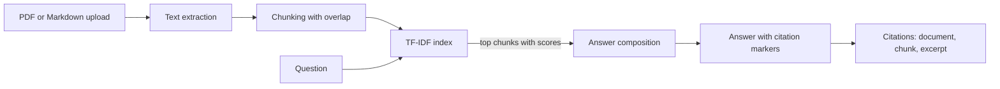

# RAG Report Assistant

Ask questions of business documents and get answers with citations. A RAG based reporting assistant built with FastAPI, React and TypeScript.

Upload PDF or Markdown documents, ask a plain language question, and get an answer where every claim points back to the source document and the exact chunk it came from. Three short fictional sample reports are indexed on startup, so the demo works the moment the API is running.

## Quickstart

You need Python 3.11 or newer and Node 20 or newer. No API key is required.

Backend:

```bash
cd backend
python -m venv .venv
source .venv/bin/activate
pip install -r requirements.txt
uvicorn app.main:app --reload --port 8000
```

Frontend, in a second terminal:

```bash
cd frontend
npm install
npm run dev
```

Open http://localhost:5173, or talk to the API directly:

```bash
curl -X POST localhost:8000/ask -H "Content-Type: application/json" \
  -d '{"question": "How much were Scope 2 emissions?"}'
```

```json
{
  "answer": "Scope 2 emissions were 16,340 tonnes using the market based method. [1] ...",
  "mode": "extractive-demo",
  "citations": [
    {
      "ref": 1,
      "document": "emissions-summary.md",
      "chunk_id": "emissions-summary.md#chunk-2",
      "score": 0.4662,
      "excerpt": "...Scope 2 emissions were 16,340 tonnes using the market based method. The cooperative signed a renewable power purchase agreement in January 2026..."
    }
  ]
}
```

Interactive API docs are at http://localhost:8000/docs. Docker users can run `docker compose up --build` from the repo root instead, which starts both services.

## How it works



1. **Ingest.** PDFs are read with pypdf; Markdown and text files are decoded directly.
2. **Chunk.** Text is split on paragraph boundaries into chunks of at most 900 characters with a 150 character overlap, so facts near a boundary stay retrievable.
3. **Retrieve.** Each chunk becomes a TF-IDF vector. A question is vectorized the same way and ranked by cosine similarity. Every result carries its similarity score.
4. **Answer.** The answer is composed from the retrieved passages, and each sentence is tagged with the citation number of its source chunk.

## Demo mode and Azure OpenAI

The default is **demo mode**: retrieval uses a local TF-IDF index and answers are composed extractively from the retrieved passages. This choice is deliberate. It needs no model downloads and no API key, it runs anywhere, and its answers are deterministic, which keeps the test suite reliable. The trade off is that answers quote and stitch source sentences instead of paraphrasing them.

To use **Azure OpenAI** for generation, set these environment variables for the backend:

| Variable | Purpose |
| --- | --- |
| `AZURE_OPENAI_ENDPOINT` | Resource endpoint, for example https://my-resource.openai.azure.com |
| `AZURE_OPENAI_API_KEY` | Resource key |
| `AZURE_OPENAI_CHAT_DEPLOYMENT` | Chat model deployment used to write answers |
| `AZURE_OPENAI_EMBEDDING_DEPLOYMENT` | Reserved for embedding based retrieval |
| `AZURE_OPENAI_API_VERSION` | Optional, defaults to 2024-10-21 |

When a chat deployment is configured, answers are generated by the model from the retrieved context only, with the same citation markers. If the call fails, the API falls back to extractive mode rather than failing the request. The retrieval layer is built behind a small interface (`DocumentIndex.search` returning scored chunks), so replacing TF-IDF with dense embeddings from the embedding deployment only changes how vectors are built, not the API contract.

## API summary

| Endpoint | Description |
| --- | --- |
| `GET /health` | Status, generation mode, document and chunk counts |
| `GET /documents` | Indexed documents with chunk counts |
| `POST /documents` | Upload a PDF or Markdown file and index it |
| `POST /ask` | Body: `{"question": "...", "top_k": 4}`. Returns an answer, the mode, and citations |

## Tests

```bash
cd backend
pip install -r requirements-dev.txt
python -m pytest
```

The suite covers chunking boundaries and overlap rules, retrieval ranking and no-match behaviour, PDF and Markdown ingestion, and the `/ask` endpoint including citation shape and the unknown topic case. CI (GitHub Actions) runs the backend tests plus a frontend typecheck and build on every push.

## What this demonstrates

- **RAG systems**: end to end retrieval augmented generation, ingestion, chunking strategy, vector search, and grounded answers.
- **AI integrated reporting**: business documents become a question answering surface, the same pattern used to put GPT workflows on top of enterprise reporting.
- **Citations as a design constraint**: answers are only useful in a reporting context if every claim can be traced to a source passage, so citations are part of the API contract, not an afterthought.
- **API design**: a small FastAPI service with typed request and response models, automatic OpenAPI docs, and a clean separation between ingest, retrieval, and generation.
- **TypeScript front end**: a React single page app with clickable citations that scroll to and highlight the source passage.
- **CI/CD**: GitHub Actions runs backend tests and the frontend build on every push; the backend ships with a Dockerfile and the repo includes a docker compose setup.
- **Pragmatic model strategy**: local retrieval and extractive answers by default for reliability, with Azure OpenAI as a configuration switch rather than a rewrite.

## Sample data

Everything in `backend/sample_docs` is fictional and was written for this project: a quarterly operations report for Northwind Field Services, an emissions summary for Harborline Energy Cooperative, and a status report for Project Beacon. No real company data is included.

## License

MIT. See [LICENSE](LICENSE).
